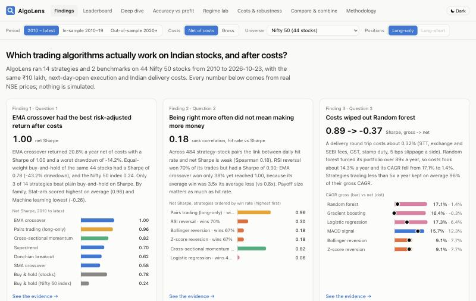
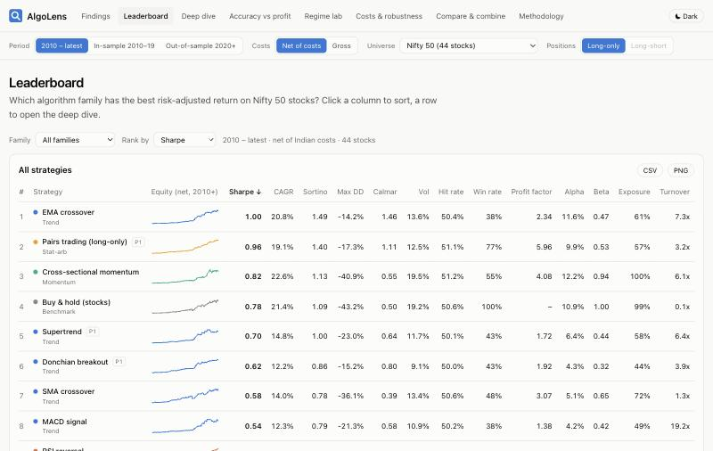
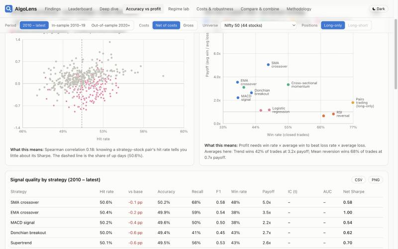
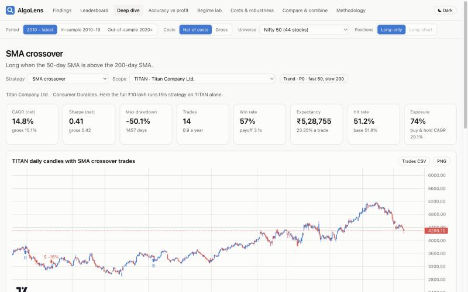
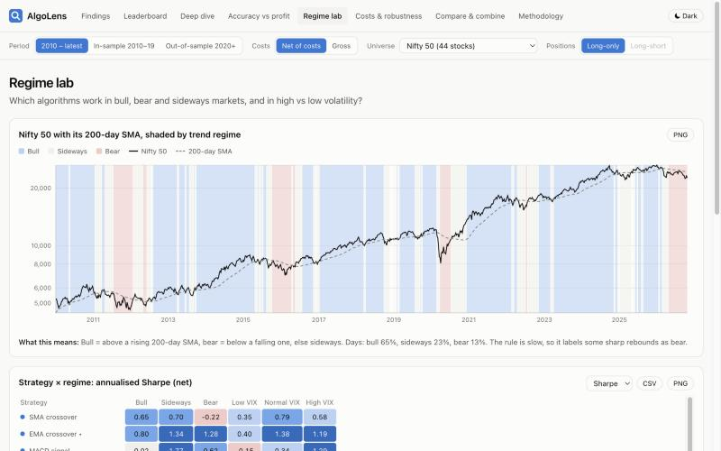

# AlgoLens

**Which trading algorithms actually work on Indian stocks, and after costs?**

AlgoLens runs 14 trading strategies and 2 benchmarks on 44 Nifty 50 stocks from January 2010 to October 2026, using real NSE prices only.
Every strategy gets the same rules (₹10 lakh, next-day-open execution, Indian delivery costs), and every strategy is scored on two separate axes:
**accuracy** (is the signal right?) and **effectiveness** (does it make risk-adjusted money after costs?).

> Educational project, not investment advice.



## What the data says (run of 23 Oct 2026)

| Strategy | CAGR (net) | Sharpe (net) | Sharpe (gross) | Max DD | Sharpe 2020+ | Hit rate |
|---|---|---|---|---|---|---|
| EMA crossover 12/26 | 20.8% | 1.00 | 1.08 | -14% | 0.97 | 50.4% |
| Pairs trading (long-only) | 19.1% | 0.96 | 1.00 | -17% | 0.97 | 51.1% |
| Cross-sectional momentum 12-1 | 22.6% | 0.82 | 0.87 | -41% | 0.66 | 51.2% |
| *Buy & hold (same 44 stocks)* | 21.4% | 0.78 | 0.78 | -43% | 0.52 | 50.6% |
| Supertrend 10/3 | 14.8% | 0.70 | 0.78 | -23% | 0.78 | 50.1% |
| Donchian 55/20 | 12.2% | 0.62 | 0.69 | -15% | 0.61 | 50.0% |
| SMA crossover 50/200 | 14.0% | 0.58 | 0.59 | -36% | 0.16 | 50.6% |
| MACD 12/26/9 | 12.3% | 0.54 | 0.83 | -21% | 0.81 | 50.2% |
| RSI(14) reversal | 8.5% | 0.30 | 0.36 | -28% | 0.07 | 51.5% |
| *Buy & hold (Nifty 50 index)* | 9.4% | 0.24 | 0.25 | -38% | 0.26 | 52.9% |
| Bollinger (20, 2σ) reversion | 7.7% | 0.18 | 0.35 | -31% | -0.08 | 51.4% |
| Z-score (20) reversion | 7.7% | 0.18 | 0.35 | -31% | -0.08 | 51.4% |
| Logistic regression | 6.4% | 0.06 | 0.81 | -37% | -0.04 | 51.0% |
| Dual momentum (Nifty) | 4.6% | -0.09 | -0.06 | -22% | -0.10 | 52.1% |
| Random forest | 1.4% | -0.37 | 0.89 | -48% | -0.34 | 51.6% |
| Gradient boosting | -0.3% | -0.47 | 0.78 | -49% | -0.58 | 51.5% |

Headline findings (the app writes these from the results; they change if the data changes):

1. **Being right more often did not mean making more money.** Across 484 strategy-stock pairs, hit rate and Sharpe have a rank correlation of only 0.18. RSI reversal wins 70% of its trades but has a Sharpe of 0.30; EMA crossover wins 38% and reaches 1.00, because its average win is 3.5x its average loss.
2. **Costs destroyed the ML models.** A delivery round trip costs about 0.32%. The random forest traded 89x its capital a year, and its CAGR fell from 17.1% gross to 1.4% net.
3. **ML did not beat simple rules.** Walk-forward out-of-sample AUC was 0.507–0.513, barely better than a coin flip.
4. **The best in-sample settings never stayed the best.** In 0 of 6 parameter grids was the best 2010–19 setting still #1 after 2020. After deflating for the 84 configurations tested, no strategy clears 95% confidence.
5. **Most strategies did better in high volatility** (average Sharpe 0.73 on high-VIX days vs -0.17 on low-VIX days).
6. **Survivorship bias is large.** Today's constituents held from 2010 returned 21.4% a year vs 9.4% for the Nifty price index. Compare strategies with stock buy-and-hold, not with the index.

## The app (8 pages)

| Page | Answers |
|---|---|
| Findings | The 2-minute story: data-backed insight cards, top 5, hit rate × Sharpe chart |
| Leaderboard | Sortable table with sparklines, metric picker, family filter, sector universes, CSV export |
| Strategy deep dive | Equity vs Nifty (gross and net), drawdown, monthly heatmap, trade distribution; per stock: TradingView candlesticks with buy/sell markers and the full trade list |
| Accuracy vs effectiveness | Hit rate × Sharpe scatter (484 points), win rate × payoff quadrant, confusion matrices, ROC curves, AUC by year, calibration, feature importance |
| Regime lab | Nifty shaded by bull/bear/sideways, strategy × regime heatmap, trend × VIX grid |
| Costs & robustness | Gross vs net, slippage and brokerage sliders, parameter heatmaps, in-sample vs out-of-sample, yearly walk-forward timeline, bootstrap CIs, deflated Sharpe |
| Compare & combine | Overlay up to 4 equity curves, build an equal-weight mix, correlation matrix |
| Methodology & data | Sources, biases, cost model with citations, metric definitions, corporate-action fixes, data-quality report |

Global filters (period, gross/net, universe) live in the URL, so every view can be shared. Dark/light theme, phone-width layout, CSV and PNG export.

| | |
|---|---|
|  |  |
|  |  |

## Run it

Needs Python 3.12 with [uv](https://docs.astral.sh/uv/), and Node 18+ with pnpm.

```bash
make setup      # uv sync + pnpm install
make data       # download NSE / Yahoo / Kaggle data, clean it, print a data-quality report
make backtest   # ML walk-forward + all strategies -> web/public/results/*.json
make test       # look-ahead, metric and engine tests (30 tests)
make web        # http://localhost:5173
```

`make verify` re-runs the hand-calculated SMA 50/200 check on Reliance; the engine matches a plain cash-and-shares loop to 1e-15.

**Deploy:** the app is static. On Vercel, set the root directory to `web`, the build command to `pnpm build` and the output to `dist`. `web/vercel.json` handles client-side routes. The JSON results are committed, so the deploy needs no Python.

## How it works

```
pipeline/
  ingest.py        NSE constituents, Yahoo (yfinance) OHLCV + adj close, India VIX, Kaggle cross-check -> data/raw/
  clean.py         adjust OHLC, drop stale rows, apply documented corporate-action fixes, data-quality report
  corporate_actions.csv  demergers / bonus Yahoo gets wrong, each with a public source
  indicators.py    SMA, EMA, RSI, MACD, Bollinger, ATR, Donchian, Supertrend (all causal)
  strategies/      rules.py (per-stock), portfolio.py (momentum, dual momentum, pairs), registry.py
  ml/              features.py, walkforward.py (yearly expanding-window retrain)
  backtest.py      sleeve engine (vectorised) + portfolio engine (daily loop); signal at close t -> trade at open t+1
  costs.py         STT, NSE, SEBI, GST, stamp duty, slippage (rates checked against Zerodha's charge sheet)
  metrics.py       accuracy + effectiveness metrics, bootstrap CI, deflated Sharpe
  regimes.py       bull/bear/sideways x VIX terciles
  export.py        runs everything, writes web/public/results/*.json
  findings.py      headline findings computed from the results
web/               Vite + React 18 + TypeScript + Tailwind + Recharts + Lightweight Charts
tests/             look-ahead tests, metric unit tests, engine-vs-hand check
```

**Fairness rules:** same universe, dates, ₹10 lakh capital, cost model and execution for all strategies. Long-only. Per-stock strategies give each stock an equal sleeve and sum the sleeves (no hidden rebalancing). Idle cash earns the 6.5% risk-free rate. ML models only ever train on rows whose target date is before their test year (unit-tested).

## Limitations and open items

- **Universe is 44 stocks, not 45+.** Only 44 of today's 50 constituents have 10+ years of history (BSE, Eternal, HDFC Life, SBI Life, Jio Financial and Max Healthcare are newer). Lower `MIN_HISTORY_YEARS` in `pipeline/config.py` to include more.
- **Survivorship bias:** current constituents only. The Nifty index is a price index (no dividends).
- **XGBoost (P1)** is replaced by scikit-learn's HistGradientBoosting, because the XGBoost macOS wheel needs `brew install libomp`. LSTM (P2) is not built.
- **Not built yet:** long-short mode, market-cap tier comparison (Nifty 50 vs Next 50 vs Midcap, needs the NSE 200 Kaggle set), S&P 500 comparison, intraday data.
- Risk-free rate is a constant 6.5%, not the RBI T-bill series. DP charges (~₹15 per sell) are not modelled.
- Bollinger (20, 2σ, exit at mid) and Z-score (20, -2, exit at 0) are the same rule, so their results are identical. The app says so.

## Data sources

- NSE Nifty 50 constituent list: https://nsearchives.nseindia.com/content/indices/ind_nifty50list.csv
- Yahoo Finance via [yfinance](https://github.com/ranaroussi/yfinance): `<SYMBOL>.NS`, `^NSEI`, `^INDIAVIX` (personal and educational use)
- Kaggle [rohanrao/nifty50-stock-market-data](https://www.kaggle.com/datasets/rohanrao/nifty50-stock-market-data): cross-check (see the dataset page for its licence; not redistributed here)
- Cost rates: [Zerodha charges](https://zerodha.com/charges/), checked 25 Oct 2026
